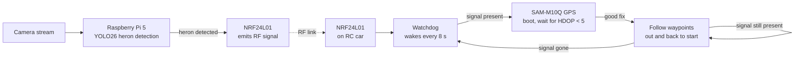

# Heron Patrol - self driving RC Car

**Heron detection, RF signaling, and autonomous GPS waypoint patrols for backyard heron deterrence**

---

## Overview

Autonomous heron deterrent for the backyard. A Raspberry Pi 5 watches a live
camera feed with YOLO26; when it spots a heron, it signals an RC car over an
NRF24L01 radio link, and the car runs a GPS waypoint patrol until the heron
leaves.

## Architecture

### System overview

### Detection node — Raspberry Pi 5

- Ingests a continuous stream of camera images.
- Runs YOLO26 inference on the frames to detect herons.
- While a heron is detected, the attached NRF24L01 module continuously
  emits its RF signal.

### Patrol node — RC car

- **Watchdog:** the car sits in low-power watchdog mode, waking up every
  8 seconds to check whether its NRF24L01 is receiving the Pi's signal.
- **Signal present:** boots the SAM-M10Q GPS and waits until it has a solid
  position fix (HDOP < 5).
- **Patrol:** follows a pre-set list of GPS waypoints placed around the
  backyard — driving the path out and then back down to its starting
  location.
- **Repeat or stand down:** after completing the loop, if the Pi is still
  emitting (heron still detected) the car runs the patrol again. If the
  signal is gone, it powers back down into watchdog mode.

## Hardware

| Part                          | Role                                                 |
| ----------------------------- | ---------------------------------------------------- |
| Raspberry Pi 5 + camera       | Heron detection node                                 |
| Arduino Uno                   | works as RC car's VCU                                |
| NRF24L01 × 2                  | RF link — transmitter on the Pi, receiver on the car |
| RC car chassis                | Autonomous patrol platform                           |
| u-blox SAM-M10Q               | GPS positioning on the car                           |
| quicrun 1060 esc              | controls motor of the car                            |
| Comimark 2Pcs GY-273 HMC5883L | triple axis compass magnetometer                     |

## Repository layout

- `RC_Car/`

* `RC_Car.ino` - reads gps values, direct esc, changes steering inputs based on where the car is facing, and where the waypoint is relative to the car's location
* `Coordnate.cpp/h` - takes the gps values and compares it to the added waypoints (calculates angle and distances between current locaition, and current waypoint.)

- `data.yaml`, `images_*.zip`, `labels_*.zip` — Roboflow heron dataset used
  for the YOLO26 detector

## Waypoints

The patrol route is a pre-planned set of GPS coordinates ringing the
backyard. The car drives the loop outward and returns to its start point.
(Tune the coordinates in `RC_Car/`.)

## To Do
- Add in software for the compass.
- Get through all waypoints.
- Python script that takes in imaging from camera
- add in ability to save when a heron in on camera, to confirm enough data is in database.
- 3d print case for camera/pi5

## Author

**Nicholas Gowin**
